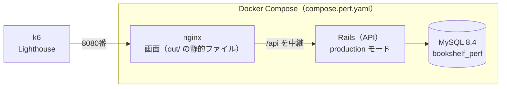

# パフォーマンステスト：読書記録アプリ（本棚アプリ）

本アプリの性能を確かめるテストの方針・ツール・シナリオ・目標値を定める。性能の要件は、要件定義書（[requirements.md](requirements.md) 7章）の「個人利用の規模（書籍数百件程度）で操作が快適に行えること」だけである。この「快適」を数値で確かめられるようにすることが目的である。

パフォーマンステストは、PR のたびに動く CI（[tech-stack.md](tech-stack.md) 7章）には入れない。**好きなときに、ローカルのスクリプトで実行する。**

## 1. 確かめること

1人で使うアプリで、ログインもないため、大勢が同時に使う負荷テストは行わない。次の2点を確かめる。

| 観点 | 内容 |
|---|---|
| A. データが増えたときの API の速さ | 書籍が 300件・1,000件・3,000件のときに、API の応答時間がどう変わるか |
| B. 画面の読み込みと操作の速さ | 画面はブラウザ側で描画する（CSR）。カードが多いときの初期表示、ドラッグ&ドロップ、検索、グラフの表示が重くならないか |

実装を読んで、遅くなるおそれがあると考えた箇所を、特に重点的に測る。

| API | 気になる点 |
|---|---|
| API-05（ボード） | 本棚の書籍をタグと一緒にすべて読み込み、Ruby 側で3列に分けている。キーワード検索（`q`）の `LIKE '%…%'` はインデックスを使えない。どちらも件数に比例して遅くなるはず |
| API-09（ドラッグ&ドロップ） | 移動元と移動先の列の `position` を振り直すため、列の冊数が多いほど UPDATE の件数が増える。同時に動かしたときのデッドロックのやり直し（`BooksController#retry_on_lock_conflict`）が働くかも確かめる |
| API-12（月別の読了冊数） | `index_books_on_status_and_finished_on` が使われているかを `EXPLAIN` で確かめる |

## 2. ツール

| 対象 | ツール | 使い方 |
|---|---|---|
| API の応答時間 | k6 | Docker イメージ（`grafana/k6`）を `docker run` で動かす。PC へのインストールはしない。シナリオは JavaScript で書く |
| テストデータ | Rails の rake タスク（`perf:seed`） | `insert_all` で、件数を指定して書籍・タグを作る |
| SQL | MySQL の `EXPLAIN`、Rails のログ | クエリの数（N+1 がないか）と、インデックスが使われているかを確かめる |
| 画面の読み込み | Lighthouse CI（`@lhci/cli`） | `npx` で実行する。`package.json` には加えない |
| 画面の操作 | Chrome DevTools の Performance パネル | ドラッグ&ドロップや検索の入力の応答（INP）、長い処理（Long Task）を手動で計測する |
| 画面のファイルの大きさ | `next build` の出力 | ページの JavaScript の大きさを記録する |

## 3. 計測用の環境

開発用の環境（`docker compose up`）は、Rails が development モード、画面が `next dev` で動くため、本番より遅く、計測には向かない。本番（AWS、[infrastructure.md](infrastructure.md)）に近い計測用の環境を、`compose.perf.yaml` で別に立ち上げる。



| サービス | 内容 |
|---|---|
| nginx | `next build` で書き出した `frontend/out/` を返し、`/api` を Rails へ中継する。本番のフロントエンドのサーバーと同じ形 |
| backend | 本番用の `backend/Dockerfile` を使い、`RAILS_ENV=production` で動かす |
| db | MySQL 8.4。**開発用とは別のボリュームと DB（`bookshelf_perf`）を使う** |

- 計測のためにデータを大量に入れたり消したりするため、ふだん開発で使っているデータ（`db-data`）とは完全に分ける
- 開発用の環境とポートが重ならないようにし、`127.0.0.1` からの接続だけを受け付ける（tech-stack.md 6章と同じ理由）
- 計測するときは、ほかの重いアプリを閉じ、同じ条件で行う

## 4. テストデータ

`perf:seed` タスクで、指定した件数の書籍を作る。

| 項目 | 内容 |
|---|---|
| 件数 | 300件（要件の規模）・1,000件・3,000件（要件の約10倍。余裕を確かめる） |
| 本棚 | 3つ。書籍の大半は1つ目の本棚に入れ、ボードの1画面に多くのカードが並ぶようにする |
| ステータス | 未読：読書中：読了 ＝ 4：1：5 程度 |
| 読了日 | 読了の書籍は、直近24ヶ月に散らばるようにする |
| タグ | 30個。1冊に0〜3個を付ける |
| 書影画像URL | 空にする（外部の画像の読み込みにかかる時間を計測に含めないため） |

- データは毎回作り直し、乱数の種（seed）を固定して、同じデータで比べられるようにする
- 誤って開発用や本番の DB を消さないように、タスクは DB 名が `bookshelf_perf` のときだけ動くようにする

## 5. シナリオ

| ID | 種類 | 内容 | 負荷 |
|---|---|---|---|
| P-01 | スモーク | すべての API を1回ずつ呼び、エラーがないことを確かめる。ほかのシナリオの前に行う | 1人・1回 |
| P-02 | 件数による変化 | 300件・1,000件・3,000件のそれぞれで、API-05（絞り込みなし・`q`・`tag_id`）、API-07、API-11、API-12 の応答時間を測る | 1人・各50回 |
| P-03 | ふだんの操作 | 画面を開く（API-01・05・11・12）→ 検索する（API-05）→ カードを動かす（API-09）→ 編集する（API-07・08）を繰り返す | 1〜5人・3分 |
| P-04 | 同時の並べ替え | 同じ本棚の同じ列で API-09 を同時に送る。デッドロックによるエラーが返らないこと、終わったあとに `position` が 1 から連番になっていることを確かめる | 10人・1分 |
| F-01 | 画面の読み込み | 300件・1,000件で Lighthouse を3回ずつ実行し、中央値をとる | － |
| F-02 | 画面の操作 | 1,000件で、ボードのドラッグ&ドロップ、検索の入力、月の切り替えを DevTools で計測する | 手動 |

- 「人」は k6 の仮想ユーザー（VU）の数。1人で使うアプリのため、P-03 の 5人は、複数のタブや端末から同時に操作した場合を想定した多めの値である
- P-03・P-04 はデータを書き換えるため、P-02 のあとに行い、終わったらデータを作り直す

## 6. 目標値

| 対象 | 目標 | 条件 |
|---|---|---|
| 読み取りの API（API-01・05・07・11・12） | 95% のリクエストが 200ms 未満（p95） | 300件 |
| 書き込みの API（API-02〜04・06・08〜10） | p95 が 300ms 未満 | 300件 |
| エラー | 1% 未満。P-04 では、デッドロックによるエラーが 0件 | すべて |
| 画面の読み込み | LCP（主な内容が表示されるまで）2.5秒未満、TBT（操作できない時間の合計）200ms 未満 | 300件 |
| 画面の操作 | INP（操作してから画面が変わるまで）200ms 未満 | 300件 |
| 余裕 | 3,000件でも、上の目標の2倍以内 | 3,000件 |

- 数値は、Web の一般的な目安（LCP・INP は Google の Core Web Vitals の「良好」の基準）をもとにした仮の値で、最初の計測の結果を見て見直す
- API の目標は k6 の `thresholds` に書き、超えたときはコマンドが失敗で終わるようにする

## 7. 実行方法

入口のスクリプト `perf/run.sh` から実行する。

```bash
./perf/run.sh up               # 計測用の環境をビルドして起動する
./perf/run.sh seed 1000        # 計測用の DB を、書籍 1,000件で作り直す
./perf/run.sh api smoke        # k6 のシナリオを実行する（smoke / scaling / user_flow / move_concurrency）
./perf/run.sh lighthouse       # Lighthouse CI を実行する
./perf/run.sh down             # 計測用の環境を止める
```

- 結果は `perf/results/<日時>/` に保存する（Git には含めない）
- 計測した結果のうち、残しておきたいもの（最初の計測、改善の前後）は、9章に表で記録する

### ファイルの構成

```
bookshelf-app/
├── compose.perf.yaml            # 計測用の環境（3章）
├── perf/
│   ├── README.md                # 実行方法の詳しい説明
│   ├── run.sh                   # 入口のスクリプト
│   ├── nginx.conf               # 計測用の nginx の設定
│   ├── k6/
│   │   ├── lib/                 # 共通の処理（API の呼び出し、目標値）
│   │   └── scenarios/           # P-01〜P-04
│   ├── lighthouse/lighthouserc.json
│   └── results/                 # 計測結果（Git に含めない）
└── backend/lib/tasks/perf.rake  # perf:seed（4章）
```

## 8. 進め方

| 順番 | 内容 |
|---|---|
| 1 | 本ドキュメントを作る |
| 2 | 計測用の環境（`compose.perf.yaml`、`perf:seed`、`perf/run.sh`）を作る |
| 3 | k6 のシナリオ（P-01〜P-04）と目標値を作る |
| 4 | Lighthouse（F-01）と、画面の操作の計測手順（F-02）を作る |
| 5 | 最初の計測を行い、結果を9章に記録する。目標に届かない箇所は、改善の Issue を作る |

## 9. 計測結果

（最初の計測のあとに記録する）

## 10. 設計上の判断とその理由

| 論点 | 採用した設計 | 検討した他の案 | 採用理由 |
|---|---|---|---|
| 実行のタイミング | 好きなときにローカルで実行する | PR のたびに CI で実行する | 計測には数分かかり、結果も実行する環境でぶれる。性能に関わる変更をしたときや、まとまった機能を作ったあとに測れば十分 |
| 確かめる観点 | データの件数による変化と、画面の速さ | 同時アクセスの限界を測る負荷テスト | 1人で使うアプリで、要件も「数百件で快適」である。同時アクセスの限界を知っても使い道がない |
| 計測する環境 | ローカルの本番に近い環境（production モード・静的書き出し・専用の DB） | 開発用の環境／AWS の本番環境 | 開発用の環境は本番より遅く、正しい値にならない。AWS の RDS には実際の読書データがあり、テストのデータを入れたくない。t3.micro は CPU クレジット制で、負荷をかけ続けると途中から遅くなり、無料利用枠の時間も使う |
| API の計測ツール | k6 | JMeter／Gatling／Apache Bench | シナリオを JavaScript で書け、目標値を超えたら失敗にする仕組みがある。Docker で動かせるため、インストールがいらない。JMeter・Gatling はこの規模には大きすぎ、Apache Bench は1つの URL しか試せない |
| 画面の計測ツール | Lighthouse CI ＋ DevTools（手動） | Playwright で操作を自動化して測る | 読み込みは Lighthouse で数値を残せる。ドラッグ&ドロップなどの操作は回数が少なく、手動で測るほうが簡単。Playwright は E2E テストと同じく範囲外とした（tech-stack.md 8章） |
| テストデータの作り方 | rake タスクで `insert_all` を使う | API を呼んで登録する／SQL ファイルを用意する | 3,000件でも数秒で作れる。件数を変えやすく、Rails のモデルの定義（ステータスなど）をそのまま使える |

## 11. 今後の課題（未対応）

- AWS の本番環境での計測（サーバーの性能や通信の時間を含めた計測。読み取りの API に限り、計測専用の本棚を使う）
- GitHub Actions の手動実行（`workflow_dispatch`）から計測できるようにする（GitHub の Actions の画面のボタンから、計測用の環境の起動と計測を行う）
